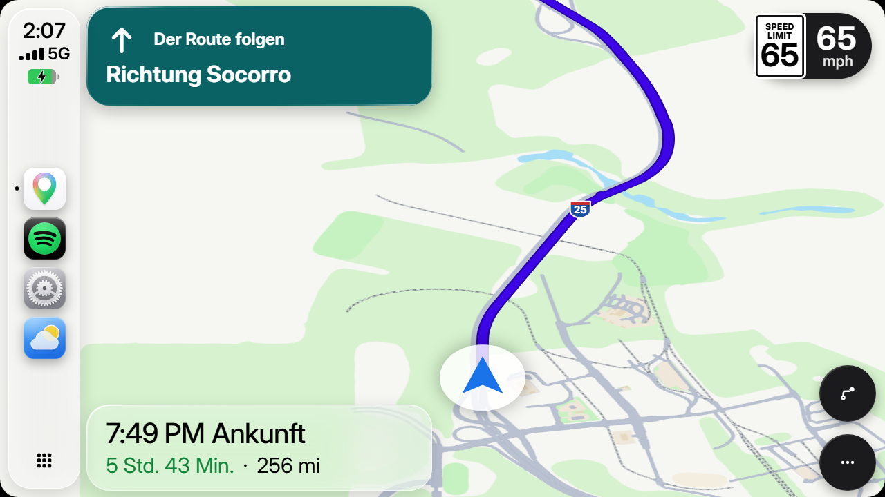
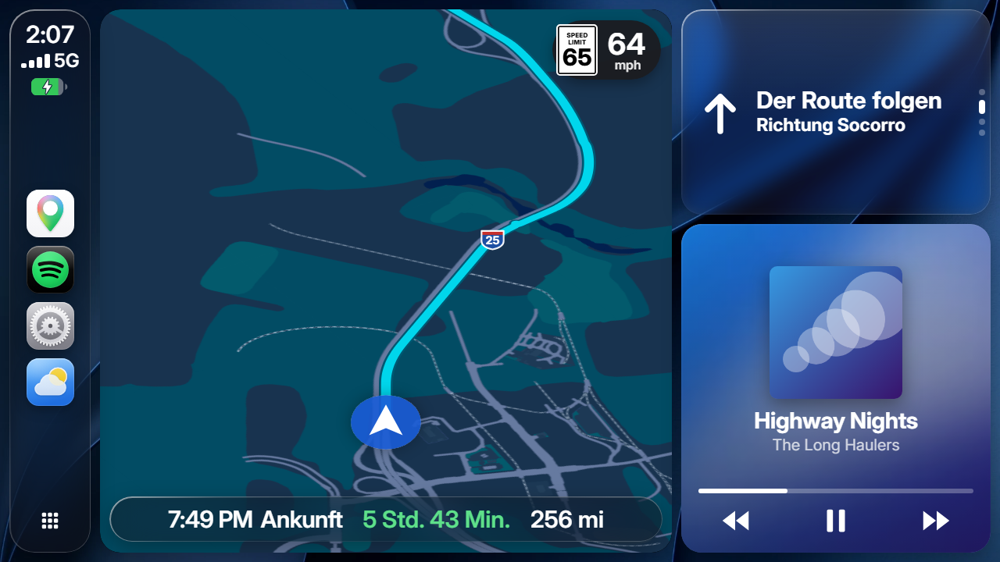

<div align="center">


# CabPlay

**Dein Truck bekommt CarPlay.**<br>
Echte Navigation mit Spurhinweisen, Spotify, Radio, Auftrag und Disponent – direkt auf dem Navi-Display im Cockpit von **Euro Truck Simulator 2** und **American Truck Simulator**.

[](../../releases/latest)


### [⬇&nbsp; CabPlay herunterladen](../../releases/latest)

[English](README.md) · Deutsch


</div>

## Was dich erwartet

🧭 **Navigation wie im echten Auto** – Abbiegehinweise, die passende Spur vor jeder Kreuzung, Wegweiser wie „Ausfahrt rechts · A1 Richtung Linz“, Ampeln mit Restzeit und Ansagen, auf Wunsch mit natürlich klingender KI-Stimme.

🗺️ **Eine Karte aus deinem Spiel** – gebaut aus deinen eigenen Spieldateien, mit allen DLCs: Straßen mit ihren Spuren, Brücken, Gebäude, Wasser, Wälder, Firmengelände. Im Stil von Google Maps oder Apple Karten, hell und dunkel.

🎵 **Musik** – Spotify mit Cover, Mediathek und mitlaufenden Songtexten, dazu über 110 Radiosender und die Sender aus deinem Spiel.

🚚 **Alles rund um die Tour** – Auftrag mit Lieferfrist und Puffer, Disponent per Nachricht und Anruf, Fahrzeugdaten mit Kontrollleuchten, Blitzer- und Waagenwarner, Tanken & Rasten, Wetter.

⚽ **Und noch mehr** – Live-Fußball, NFL und Formel 1, YouTube und Twitch, ein Dashboard mit Widgets nach deinem Geschmack und ein optionaler Sprachassistent, der komplett auf deinem PC läuft.

🖱️ **Bedienung, wie du willst** – mit der Maus direkt auf dem Display im Cockpit, mit Lenkrad-Tasten, per Tastatur oder vom Handy aus.

## In 3 Schritten startklar

1. **[Herunterladen](../../releases/latest)**, `CabPlay-Setup-….exe` installieren und CabPlay starten – es legt sein Plugin selbst in ETS2 und ATS.
2. **Spiel starten** und einmal bestätigen, dass es SDK-Plugins laden darf.
3. **Einsteigen** – CabPlay erscheint auf dem Navi-Display. Ziel im Spiel-Navi setzen oder Auftrag annehmen, los geht’s.

Ab dann startet CabPlay automatisch mit dem Spiel und hält sich selbst aktuell. Am Spiel selbst wird nichts verändert.

## Bilder

| | |
|---|---|
|  |  |
| Navi mit Spurempfehlung | Navi bei Nacht |
|  |  |
| Karte im Apple-Stil | Dashboard, hell |
|  |  |
| American Truck Simulator: Meilen, US-Schilder, 12-Stunden-Uhr | ATS-Dashboard bei Nacht |
|  |  |
| 3D-Gebäude und Firmengelände | Wälder, Fels und Serpentinen |
|  |  |
| Live-Spielstände | Home-Bildschirm |
|  |  |
| Fahrzeug mit Kontrollleuchten | Auftrag |
|  |  |
| Radio | Wetter |

## Voraussetzungen

- Windows 10 oder 11 (64 Bit)
- Euro Truck Simulator 2 und/oder American Truck Simulator in der aktuellen Version über Steam, DirectX 11
- Die originale Karte des Spiels mit deinen DLCs – Karten-Mods wie ProMods oder RPM werden nicht unterstützt
- Etwa 350 MB Platz (mit Sprachassistent mehr)

---

## Alles im Detail

<details>
<summary><b>Navigation</b></summary>

- Die Route kommt aus dem Navi des Spiels. Abbiegungen erkennt CabPlay aus den Kreuzungsdaten des Spiels – so, wie das Spiel selbst abbiegt
- Spurempfehlung vor jeder Kreuzung und Ausfahrt, ein Marker zeigt, auf welcher Spur du gerade fährst
- Fähren mit eigener Ansage „Fähre nehmen“; Richtung vom Wegweiser nur von Schildern deiner Fahrtrichtung
- Wegweiser mit Straßennummer und Ziel von den echten Schildern
- Ampeln mit Restzeit, Tempolimit, Ankunftszeit, Rastplätze entlang der Strecke, Hinweise vor Grenzen und Steigungen
- Ansagen auf Deutsch, Englisch, Polnisch oder Türkisch, mit Windows-Stimmen oder zehn KI-Stimmen (etwa 400 MB, nur auf Wunsch). Wer schon zur richtigen Spur blinkt, wird nicht unnötig ermahnt
- Optional: Warnung vor engen Kurven, wenn du zu schnell bist

Die Entfernungen bei Abbiegungen und Spuren sind die echte Strecke auf der Straße. Das Navi des Spiels rechnet in gestauchten Spielkilometern (auf dem Land etwa 1:19), deshalb weichen die Zahlen dort voneinander ab. Restkilometer, Ankunftszeit und Abstände zu Tankstellen rechnet CabPlay passend zum Spiel.

</details>

<details>
<summary><b>Die Karte</b></summary>

CabPlay liest die Karte aus den Dateien deines Spiels, mit allen DLCs, und baut sie nach Spiel-Updates selbst neu.

- Straßen so breit, wie sie Spuren haben, Brücken über den Straßen darunter, Einbahnpfeile, nah herangezoomt Fahrbahnmarkierungen und aufgemalte Abbiegepfeile
- Gebäude, Wasser, Wälder, Wiesen, Felder, Fels und Sand, Firmengelände mit Hof- und Parkflächen
- Zwei Stile wie Google Maps und Apple Karten, hell und dunkel, flach oder schräg von hinten
- Ab Werk aus, jederzeit einschaltbar: 3D-Gebäude, kleine Orte, Aussichtspunkte, versteckte Straßen und geheime Abkürzungen

Flüsse und Seen sind noch nicht überall genau. Stimmt die Karte irgendwo nicht, wählst du im Kartenmenü „Fehler auf der Karte melden“ – gern hier als Issue anhängen.

</details>

<details>
<summary><b>American Truck Simulator</b></summary>

CabPlay erkennt von selbst, welches Spiel läuft – es gibt nichts auszuwählen.

- Eigene Karte der USA, beim ersten ATS-Start aus deinen Spieldateien gebaut (etwa fünf Minuten im Hintergrund)
- Tempolimit als US-Schild „SPEED LIMIT“, Straßennummern als Interstate-, US-Highway- und State-Route-Schilder
- Bundesstaaten statt Länder: „Willkommen in Nevada“ mit den Lkw-Tempolimits des Staates
- Einheiten und Uhr wie im Spiel eingestellt, Geld in Dollar
- Statt Blitzern (gibt es in ATS nicht) Warnungen vor Waagen und Mautstellen
- Radio mit eigener Liste US-Sender und dem Online-Radio aus ATS
- Road Trip: Kurieraufträge mit dem Auto, Bronco und F-150 mit ihrem eigenen Display-Format

Breitere Displays, etwa im Freightliner Cascadia oder Western Star 57X, zeigt CabPlay unverzerrt.

</details>

<details>
<summary><b>Apps</b></summary>

- **Spotify**: Ohne Einrichtung zeigt und steuert CabPlay, was in der Spotify-App am PC läuft. Für Mediathek, Playlists, Suche und Warteschlange verbindest du einmal dein Konto (siehe unten). Songtexte laufen mit, wenn es synchronisierte gibt (LRCLIB)
- **Radio**: über 110 Sender (Deutsch, Englisch, USA, I LOVE RADIO) plus die Sender aus dem Online-Radio deines Spiels und eigene Sender
- **Sport**: Live-Spielstände, Torschützen und Tabellen – Bundesliga bis 3. Liga, DFB-Pokal, Champions League, Premier League, LaLiga, Serie A und mehr, NFL und Formel 1. Lieblingsteams bekommen einen Live-Ticker als Mitteilung
- **Auftrag**: Strecke, Lieferfrist, Puffer, Lohn, Kosten unterwegs, nächste Pause
- **Fahrzeug**: Tempo, Gang, Tank, AdBlue, Zustand von Zugmaschine und Anhänger, Kontrollleuchten und Warnlampen wie im Cockpit
- **Blitzer**, Waagen und Mautstellen mit Warnton – Blitzer, die dich erwischt haben, merkt sich CabPlay
- **Wetter** für den Ort, an dem du gerade bist (Open-Meteo, ohne Konto)
- Telefon mit Disponent und Pannenhilfe, Nachrichten, Kalender, Fahrtenbuch, Tanken & Rasten, Videos von YouTube und Twitch
- Reisebus aus dem Coach-DLC: Fahrt statt Fracht, Ankunftsfrist, Bushaltestellen auf der Karte

</details>

<details>
<summary><b>Sprachassistent (optional)</b></summary>

Home-Knopf gedrückt halten (oder Strg + Alt + V) und einfach reden, zum Beispiel „Schaffe ich die Lieferung noch?“ oder „Spiel was von AC/DC“. Das Sprachmodell läuft komplett auf deinem PC, kostet nichts und braucht kein Konto. Es wird nur geladen, wenn du es in den Einstellungen anforderst (etwa 1,5 bis 3 GB), und lässt sich jederzeit wieder entfernen. Ohne den Download versteht CabPlay feste Befehle wie „Nächste Tankstelle“ oder „Wie weit noch“.

</details>

<details>
<summary><b>Bedienung im Spiel</b></summary>

| Tasten | Was passiert |
|---|---|
| Strg + F8 | CabPlay-Menü im Spiel (Status, Display, Touch) |
| Strg + Alt + M | Touch-Modus: CabPlay mit der Maus bedienen |
| Strg + Alt + E | Editor-Fenster am PC |
| Strg + Alt + P | Musik abspielen oder pausieren |
| Strg + Alt + Bild↑ / Bild↓ | Vorheriger oder nächster Titel |
| Strg + Alt + Pfeiltasten, Enter, Rücktaste | Durch CabPlay blättern, auswählen, zurück |
| Strg + Alt + H | Home-Bildschirm |
| Strg + Alt + V | Sprachbefehl |

Alle Kürzel lassen sich ändern, auch auf Lenkrad-Tasten.

**Touch:** Entweder liegt CabPlay als Fenster über dem Spiel, oder du kalibrierst einmal das Display im Cockpit (vier Ecken anklicken) und klickst danach direkt auf den Bildschirm im Truck – Kopf- und Kabinenbewegungen rechnet CabPlay heraus. Die Kalibrierung merkt sich CabPlay für jeden Truck und jedes Auto.

**Handy:** In den Einstellungen die Handy-Steuerung einschalten und den QR-Code scannen – Handy und PC im selben WLAN.

</details>

<details>
<summary><b>Spotify-Mediathek einrichten</b></summary>

1. Auf [developer.spotify.com/dashboard](https://developer.spotify.com/dashboard) mit deinem Spotify-Konto anmelden und „Create app“ wählen. Name egal, als API „Web API“ ankreuzen.
2. Als Redirect URI genau `http://127.0.0.1:8724/callback` eintragen und speichern.
3. Die Client ID kopieren.
4. In CabPlay im Editor-Fenster unter Einstellungen › Musik › Spotify-Mediathek die Client ID einfügen, auf Verbinden klicken und im Browser zustimmen.

Die Anmeldung bleibt auf deinem PC (`%APPDATA%\CabPlay`). Zum Abspielen aus der Mediathek brauchst du Spotify Premium und eine offene Spotify-App.

</details>

<details>
<summary><b>Updates, Mods und Datensicherung</b></summary>

- **Updates**: CabPlay schaut beim Start nach einer neuen Version, lädt sie und installiert sie beim Beenden – das Plugin gleich mit. Jede Datei wird per SHA-256 geprüft, Einstellungen bleiben erhalten. Ob es eine Desktop-Verknüpfung gibt, stellst du unter Softwareupdate ein
- **Mods**: Firmen- und Städtenamen aus eingeschalteten Mods erscheinen auch auf der Karte. Karten-Mods (ProMods, RPM …) gehen nicht – dort passen Karte und Navi nicht, alles andere funktioniert
- **Datensicherung**: Einstellungen › Allgemein › „Einstellungen sichern …“ schreibt Einstellungen, gelernte Blitzer und Videos in eine Datei

</details>

<details>
<summary><b>Häufige Fragen</b></summary>

**Windows warnt beim Start („Der Computer wurde durch Windows geschützt“).**
Die Programmdatei ist nicht digital signiert. Auf „Weitere Informationen“ und „Trotzdem ausführen“ klicken. Wer sichergehen will, vergleicht die Prüfsumme mit der `SHA256SUMS.txt` im Release:

```powershell
Get-FileHash .\CabPlay-Setup-*.exe -Algorithm SHA256
```

**CabPlay erscheint nicht im Spiel.**
Das Spiel einmal ganz beenden und neu starten, die SDK-Abfrage bestätigen. In der App unter Einstellungen › Allgemein › Plugin & Spiel nachsehen, ob das Plugin installiert ist. Dann im Spiel mit Strg + F8 das Menü öffnen und Anwenden drücken.

**Die Karte ist leer oder alt.**
Einstellungen › Info › Karte neu erzeugen. Nach Spiel-Updates macht CabPlay das von selbst.

**Kostet das Leistung?**
Kaum. CabPlay zeichnet nur neu, was sich ändert, und gibt das Bild über die Grafikkarte ans Spiel.

**Ich habe noch „ETS2 CarPlay“ (1.12 oder älter).**
Einmal `CabPlay-Setup` aus den [Releases](../../releases/latest) von Hand installieren – Einstellungen und Daten ziehen mit um, danach aktualisiert sich CabPlay wieder selbst.

</details>

<details>
<summary><b>Deinstallieren</b></summary>

Über Windows › Einstellungen › Apps, in CabPlay unter Einstellungen › Allgemein › CabPlay deinstallieren oder bei der ZIP-Version mit `Deinstallieren.exe`. Entfernt werden das Plugin in beiden Spielen, die Platzhalter in `Dokumente\Euro Truck Simulator 2\CabPlay-Display` (bzw. `American Truck Simulator`) und der Programmordner. Deine Einstellungen (`%APPDATA%\CabPlay`) nur, wenn du das willst. Am Spiel bleibt alles, wie es war.

</details>

<details>
<summary><b>Lizenzen und Danke</b></summary>

- Teile des Spielplugins stammen aus dem [ETS2LA-Plugin](https://github.com/ETS2LA/plugin) (MIT).
- Die Kartendaten liest der [TruckSim-Kartenparser](https://github.com/truckermudgeon/maps) (GPL-3.0) aus den Spieldateien. Der Quellcode liegt jedem Paket bei (`resources/mapdata/parser/QUELLE.txt`).
- Meeresflächen: [Natural Earth](https://www.naturalearthdata.com/) (gemeinfrei). Liste der Dörfer im Spiel: krmarci, aus dem TruckSim-Kartenparser.
- Sport: [OpenLigaDB](https://www.openligadb.de/) (deutsche Ligen), ESPN (weitere Ligen, NFL), [Jolpica](https://jolpi.ca/) (Formel 1). Markenlogos der Trucks: Wikimedia Commons.
- Radiosender: [radio-browser.info](https://www.radio-browser.info/), Songtexte: [LRCLIB](https://lrclib.net/), Wetter: [Open-Meteo](https://open-meteo.com/) und MET Norway.
- Sprachassistent: whisper.cpp und llama.cpp (MIT), Sprachmodell Qwen (Apache 2.0), Stimmen Supertonic 3 von Supertone (OpenRAIL-M) über ONNX Runtime (MIT).
- Schrift: [Inter](https://github.com/rsms/inter) (SIL Open Font License 1.1). Gebaut mit [Electron](https://www.electronjs.org/).

</details>

---

<sub>Fan-Projekt, nicht verbunden mit SCS Software, Apple, Google oder Spotify. Die Marken gehören ihren Inhabern. Alle Änderungen: [CHANGELOG](CHANGELOG.md)</sub>
