# CabPlay

[Deutsch](README.md) · English

CabPlay brings an Apple CarPlay-style interface to the navigation display in Euro Truck Simulator 2. The screen in your cab runs real navigation with lane guidance and signposts, plus Spotify, radio, live football, your job, truck data with indicator lights, a speed camera warner and more. The map is built from your own game files, including every DLC. You control it with the mouse right on the display, with hotkeys, steering wheel buttons or from your phone.

> Up to version 1.12, CabPlay was called "ETS2 CarPlay". Updating from within the app works as usual, and your settings and data move along.

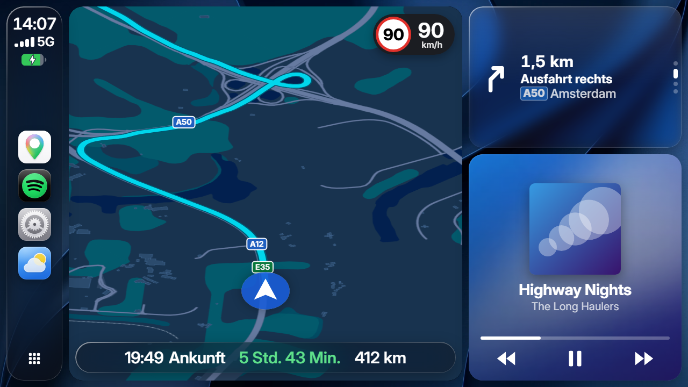

Fan project, not affiliated with SCS Software, Apple, Google or Spotify. All trademarks belong to their owners.

## Contents

- [What it does](#what-it-does)
- [Screenshots](#screenshots)
- [Requirements](#requirements)
- [Installation](#installation)
- [First start](#first-start)
- [Using it in the game](#using-it-in-the-game)
- [The map](#the-map)
- [Features in more detail](#features-in-more-detail)
- [Updates](#updates)
- [FAQ](#faq)
- [Uninstalling](#uninstalling)
- [Licenses and thanks](#licenses-and-thanks)

## What it does

### Navigation like in a real car

- The route comes from the game's navigation. The app detects turns from the game's junction data, so it turns exactly like the game does
- Lane guidance: before every junction and exit you see which lane you need. A marker shows the lane you are in right now
- Signposts: "Exit right · A1 towards Linz" with the road number and the destination from the real signs
- Traffic lights with remaining time, speed limit, arrival time, rest areas along the route, notes about borders and steep grades
- Announcements in German, English, Polish or Turkish, also with natural-sounding AI voices. If you already indicate towards the right lane, nobody nags you
- Optional: a warning before tight curves when you are too fast

### A map from your game

- Built from your game files, including every DLC. After game updates the app rebuilds it by itself
- Roads as wide as their lanes, bridges above the roads below, and when zoomed in lane markings and painted turn arrows
- Buildings, water, forests, fields, rock and sand, company sites with yards and parking
- Two styles like Google Maps and Apple Maps, light and dark, flat or tilted. In Google style the roads have the same colors as Google Maps in CarPlay
- Optional: 3D buildings, small towns, viewpoints, hidden roads and secret shortcuts

### Apps

- **Spotify** with cover art, controls, library, queue and synced lyrics. It also works when the game isn't running
- **Radio** with more than 90 stations (German, English, I LOVE RADIO and the stations from your game), plus your own
- **Sports** with live scores, goal scorers and tables: Bundesliga down to 3. Liga, DFB Cup, Champions League, Premier League, LaLiga, Serie A and more leagues, the NFL and Formula 1. Favourite teams and single matches get a live ticker as notifications
- **Job**: route, deadline, time buffer, pay, costs on the road and when your next break is due
- **Truck**: speed, gear, fuel, AdBlue, condition of truck and trailer, plus indicator lights like in the cab (indicators, lights, high beam, retarder) and warning lights for air pressure, oil pressure, engine temperature and battery
- **Speed cameras**, weigh stations and toll gates with a warning sound. The app remembers every camera that caught you
- **Weather** for the place you're driving through
- Phone with dispatcher and roadside assistance, messages, calendar, logbook, fuel & rest, videos from YouTube and Twitch
- A dashboard with widgets you arrange yourself (for example navigation, music or the live ticker), plus your own wallpapers and icons

### Voice assistant (optional)

Hold the Home button and talk, for example "Will I make the delivery?" or "Play something by AC/DC". The language model runs entirely on your PC, costs nothing and needs no account. It is only downloaded if you ask for it in the settings (about 1.5 to 3 GB) and can be removed at any time. Without the download you get fixed voice commands.

### Controls

- Touch mode in the game: click CabPlay as a window or directly on the display in the cab. The app compensates for head and cab movement
- Hotkeys for everything important, including steering wheel buttons
- Phone remote over Wi-Fi, connected via QR code
- An editor window on the PC for setting things up

### Also

- German and English, metric and US/UK units, 12 or 24 hour clock
- Updates arrive automatically. After a game update the app rebuilds the map by itself
- Nothing in the game is changed: no mods in the game files, no edits to `config.cfg`

## Screenshots

| | |
|---|---|
| 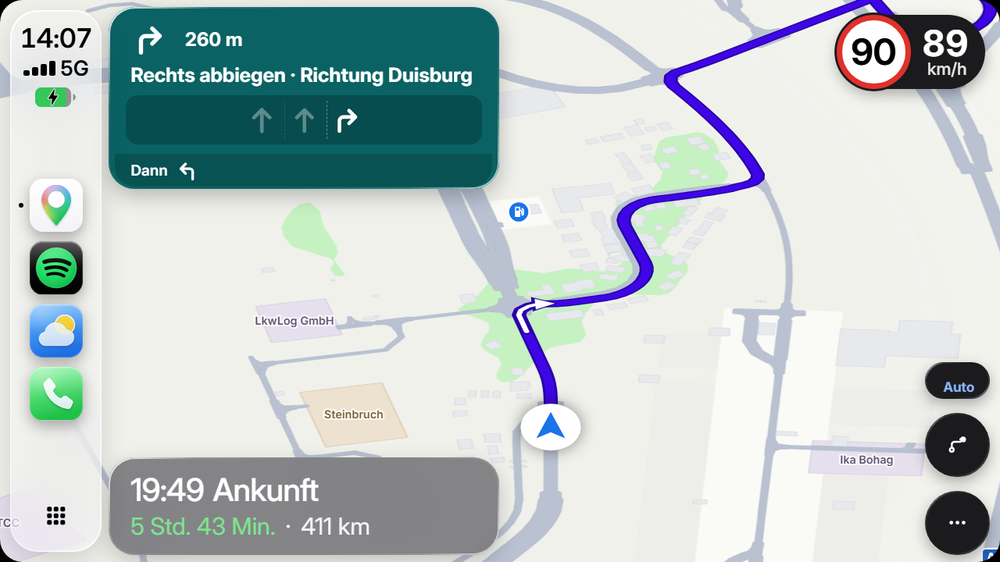 | 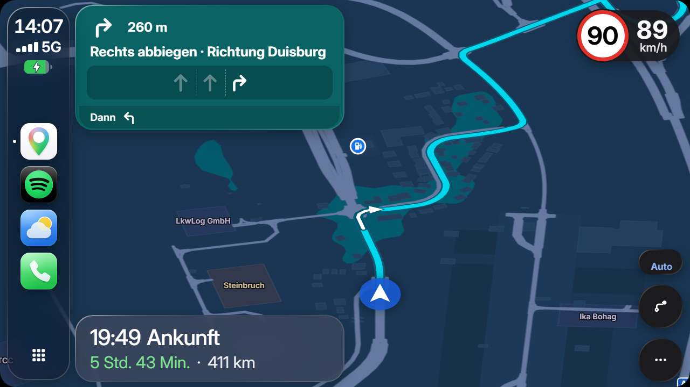 |
| Navigation in Google style with lane guidance, light | Navigation in Google style, dark |
| 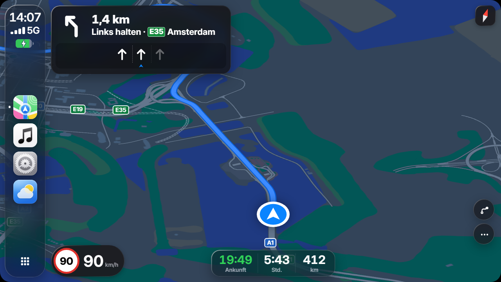 | 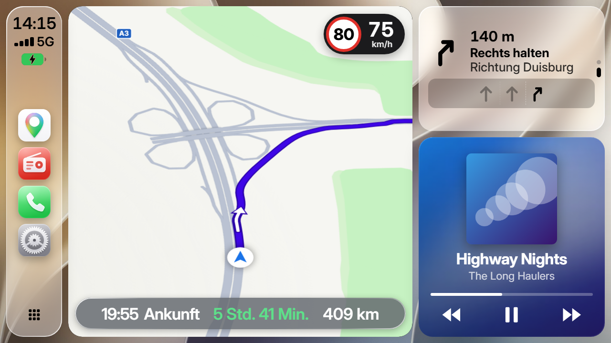 |
| Navigation in Apple style, dark | Dashboard, light |
| 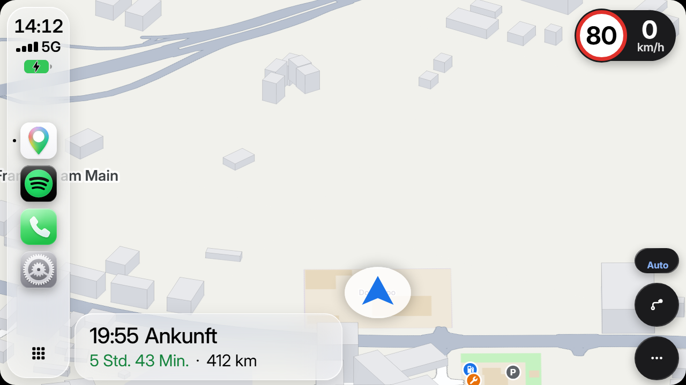 | 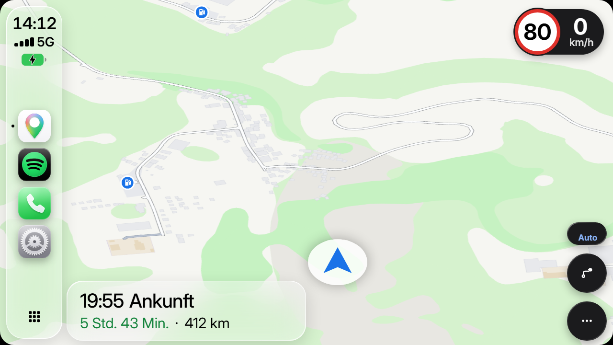 |
| 3D buildings and company sites (optional) | Forests, rock and hairpins |
| 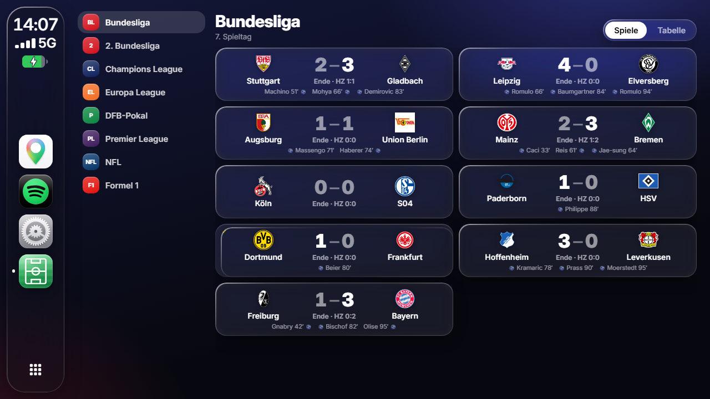 | 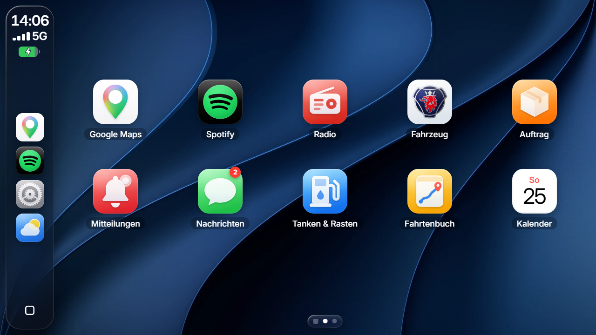 |
| Sports with live scores | Home screen |
| 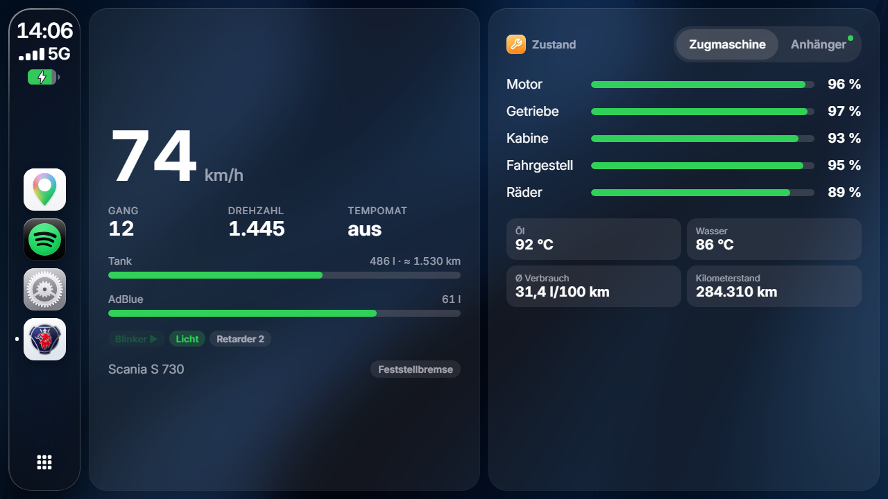 | 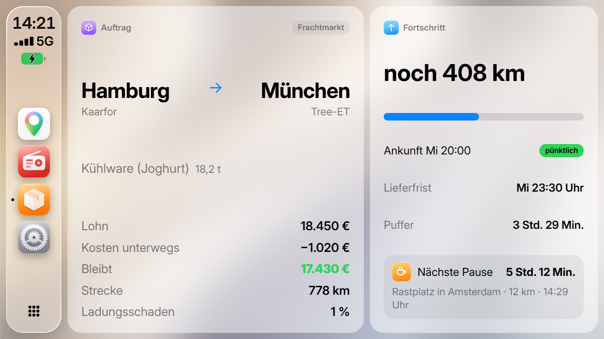 |
| Truck with indicator lights | Job |
| 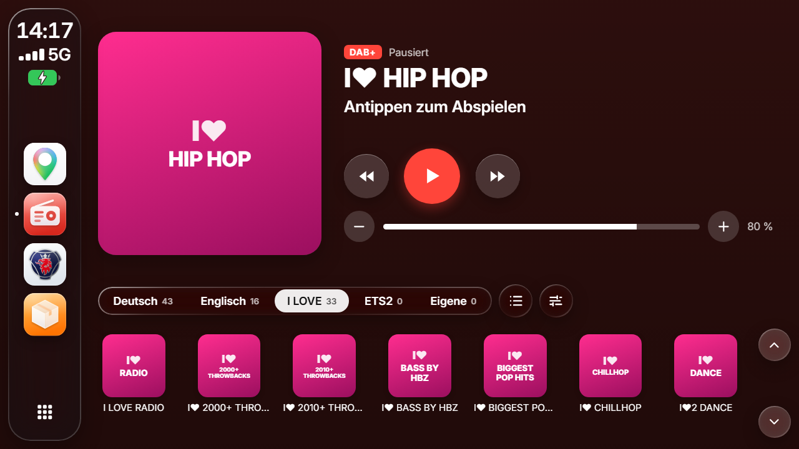 | 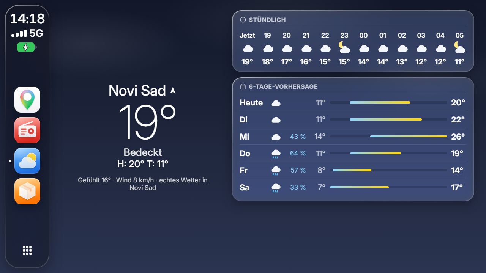 |
| Radio | Weather |
| 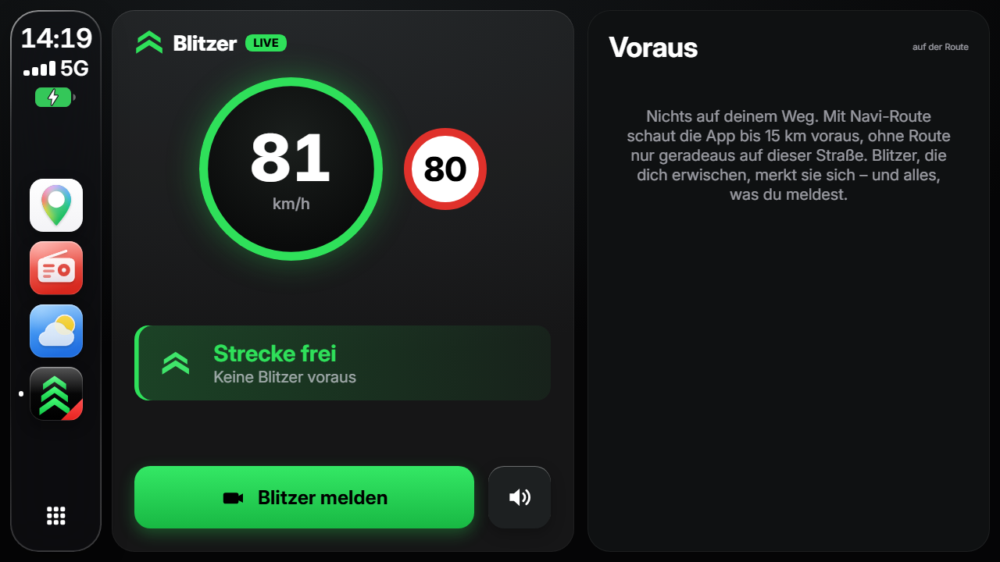 | |
| Speed cameras | |

The screenshots show the German interface. English can be switched on in the settings.

## Requirements

- Windows 10 or 11, 64 bit
- Euro Truck Simulator 2, current version (Steam), DirectX 11
- The game's original map (with all DLCs). Map mods such as ProMods or RPM (Rheinland-Pfalz 1:1) are not supported
- About 350 MB of disk space, more with the voice assistant

## Installation

1. Close Euro Truck Simulator 2.
2. Download the latest version from [Releases](../../releases). Either the installer `CabPlay-Setup-<version>.exe` (you pick the folder) or the ZIP, which you just unpack before starting `CabPlay.exe`.
3. The app finds ETS2 through Steam and copies the plugin into the game by itself. You can check that it worked under Settings › General › Plugin & game.

## First start

1. Start ETS2. The first time, the game asks whether it may load SDK plugins. Confirm with OK. From then on the game starts the app by itself.
2. Get into a truck with a navigation screen. CabPlay appears on the display.
3. F8 opens the CabPlay menu in the game. It shows the status, lets you set resolution and touch, and Apply reloads the display if needed.
4. For navigation, set a destination in the game's navigation or take a job.

On the very first start the app builds the map from your game files. That takes a minute or two and runs in the background.

## Using it in the game

| Keys | What happens |
|---|---|
| F8 | CabPlay menu in the game (status, GPS display, touch) |
| Ctrl + Alt + M | Touch mode on or off, then CabPlay works with the mouse |
| Ctrl + Alt + E | Editor window on the PC |
| Ctrl + Alt + P | Play or pause music |
| Ctrl + Alt + Page Up / Page Down | Previous or next track |
| Ctrl + Alt + arrow keys, Enter, Backspace | Move through CabPlay, select, go back |
| Ctrl + Alt + H | Home screen |
| Ctrl + Alt + V | Voice command |

You can change every hotkey in the app.

Touch mode comes in two flavours. Either CabPlay sits on top of the game as a window that you can move and resize. Or you calibrate the display in the cab once (click its four corners) and then click straight on the screen in the truck.

For the phone, turn on phone control in the settings and scan the QR code. Phone and PC need to be on the same Wi-Fi.

## The map

The app reads the map from your game files and rebuilds it after game updates. What it shows is up to you in the map settings: green areas, forests, meadows, fields, rock and sand, water, buildings, company sites, road numbers, lane markings and so on.

Bridges and overpasses visibly sit above the roads below. Roads are as wide as their lanes, and one-way roads and ramps get arrows. Zoomed in you see lane markings, solid before junctions, and the painted turn arrows on the lanes. Company sites, fuel stations and rest areas show their sub-areas like the game map.

Off by default, but can be switched on any time:
- 3D buildings: blocks in the tilted view, with the height from the game
- Small towns: villages and scenery towns that are not a city in the game. Navigation always uses them to match the direction with the signposts
- Viewpoints: the viewpoints you can discover in the game
- Hidden roads: roads the game doesn't show on its own map. Mostly scenery or only for AI traffic
- Secret shortcuts: the routes you have to discover in the game first

Water for sea, rivers and lakes comes from the game itself, the open sea from Natural Earth. Rivers and lakes are not accurate everywhere yet.

ETS2 squeezes Europe quite a lot, Dover and Calais are only a few kilometres apart for example. The map shows the world the way it is in the game.

## Features in more detail

### Spotify

Without any setup CabPlay shows what is playing in the Spotify app on your PC (title, artist, cover) and controls play, pause and skipping.

For the library with playlists, recently played, liked songs, search and queue, connect your own Spotify account once:
1. Sign in at [developer.spotify.com/dashboard](https://developer.spotify.com/dashboard) with your Spotify account and choose "Create app". Any name works, tick "Web API".
2. Enter exactly `http://127.0.0.1:8724/callback` as Redirect URI and save.
3. Copy the app's Client ID.
4. In CabPlay, in the editor window under Settings › Music › Spotify library, paste the Client ID, click Connect and approve in the browser.

The login stays on your PC (`%APPDATA%\CabPlay`), nothing goes through third-party servers. Playing from the library needs Spotify Premium and an open Spotify app. Lyrics come from LRCLIB and scroll along when synced lyrics exist for the track.

### Radio

Stations are sorted into German, English, I LOVE RADIO, ETS2 and Own. ETS2 lists the stations you added in the game. You add your own in the editor window with "+ Station": search by name (radio-browser.info directory) or enter a stream address. Radio and Spotify stop each other, and the steering wheel buttons switch stations.

### Sports

Scores, goal scorers, tables and Formula 1 without an account. Pick favourite teams by tapping a club in the table, follow a single match by tapping it. You then get a notification at kick-off, for goals, at half time and at full time. Reorder leagues by dragging and hide the ones you don't care about. As a widget, the live ticker shows your match right on the dashboard.

### Video

YouTube and Twitch links play on the display in the truck. Copy a link and paste it in the video app, or send it from your phone. If you like, the video pauses while you drive.

### Voice commands and announcements

Ctrl + Alt + V (or holding the Home button) starts a voice command, for example "Next fuel station", "How far", "Weather", "Call dispatcher" or "Next track". Without the voice assistant the Windows speech recognition understands fixed commands, with it you can talk freely. Navigation announcements use the Windows voices or one of ten extra AI voices (for example Olivia). They run right inside the app on the processor, also on mid-range PCs, and are only downloaded if you want them (about 400 MB). Announcements and warning sounds have separate volumes.

### Job, truck and bus

The dispatcher gets in touch with messages and calls. If you drive a coach from the Coach DLC, the app notices: no trailer, a trip instead of cargo, an arrival deadline and bus stops on the map.

### Weather

The real weather of the city you're driving through. It comes from Open-Meteo, with MET Norway as a fallback. Only the place is sent, no account needed.

### Mods

Company and city names from mods enabled in the game (real company names, for example) also show up on the map. The app only reads the name files. You can turn this off under Settings › Maps.

Map mods don't work: the app builds its map only from the game's original map and your DLCs. With ProMods, the added and rebuilt roads are missing, so the map, navigation and lane guidance are wrong there. RPM (Rheinland-Pfalz 1:1) and other standalone maps are a separate world – the app's map and navigation don't fit them at all. Everything else (Spotify, radio, job, truck, sports …) also works with map mods.

### Reporting map errors

If the map is wrong somewhere, say water where there is land, choose "Report a map error" in the map menu. The position and a picture are saved to `%APPDATA%\CabPlay\map-reports`. Feel free to attach them to an issue here on GitHub.

### Backing up settings

Settings › General › "Back up settings …" writes all settings, learned speed cameras and videos into one file. Handy when you move to another PC.

## Updates

The app checks for a new version every time it starts (at most every three hours, Settings › General › Software update). It downloads the update and installs it when you close the app, plugin included. Your settings are kept. Every file is checked via SHA-256 first. After an update, Software update lists what is new, with earlier versions right below.

## FAQ

**Windows shows a warning at startup ("Windows protected your PC").**
The program isn't digitally signed, so Windows doesn't know the publisher. Click "More info" and then "Run anyway". If you want to be sure, compare the checksum with `SHA256SUMS.txt` in the release:

```powershell
Get-FileHash .\CabPlay-Setup-*.exe -Algorithm SHA256
```

**CabPlay doesn't show up in the game.**
Close ETS2 completely, start it again and confirm the SDK prompt. In the app, check under Settings › General › Plugin & game that the plugin is installed. Then open the menu in the game with F8 and press Apply.

**The map is empty or outdated.**
Settings › About › Rebuild map. After game updates the app does this by itself.

**The distances for turns and lane guidance don't match the game's navigation.**
That's on purpose. ETS2 compresses the world: about 1:19 in the countryside and about 1:3 in cities. The game's navigation counts in these compressed game kilometres. For turns, lane guidance, traffic lights, sharp bends, gradients and borders, the app shows the real distance on the road ahead instead. "Turn right in 300 m" means after 300 m you actually drive. That's why the numbers in the app and the game's navigation are often far apart. Remaining distance, arrival time and the distances to fuel stations, rest areas and service shops, on the other hand, are converted to game kilometres so they match the game.

**Does it cost performance?**
Hardly. The app only redraws what changes and hands the picture to the game through the graphics card. On a normal gaming PC you won't notice a difference.

**Does it work with American Truck Simulator?**
No, only with Euro Truck Simulator 2.

## Uninstalling

Either through Windows under Settings › Apps (if you used the installer), in the app under Settings › General › Uninstall CabPlay, or for the ZIP version with `Deinstallieren.exe` in the program folder.

This removes the plugin from the game, the placeholders in `Documents\Euro Truck Simulator 2\ETS2CarPlay` and the program folder. Your settings (`%APPDATA%\CabPlay`) only if you want. The game itself stays exactly as it was.

## Licenses and thanks

- Parts of the game plugin come from the [ETS2LA plugin](https://github.com/ETS2LA/plugin) (MIT).
- Map data is read from the game files with the [TruckSim map parser](https://github.com/truckermudgeon/maps) (GPL-3.0). Its source code ships with every package (`resources/mapdata/parser/QUELLE.txt`).
- Sea areas: [Natural Earth](https://www.naturalearthdata.com/) (public domain). List of villages in the game: krmarci, from the TruckSim map parser.
- Sports: [OpenLigaDB](https://www.openligadb.de/) (German leagues), ESPN (more leagues, NFL), [Jolpica](https://jolpi.ca/) (Formula 1). Truck brand logos: Wikimedia Commons.
- Radio stations: [radio-browser.info](https://www.radio-browser.info/), lyrics: [LRCLIB](https://lrclib.net/), weather: [Open-Meteo](https://open-meteo.com/) and MET Norway.
- Voice assistant: whisper.cpp and llama.cpp (MIT), Qwen language model (Apache 2.0), Supertonic 3 voices by Supertone (OpenRAIL-M) via ONNX Runtime (MIT).
- Font: [Inter](https://github.com/rsms/inter) (SIL Open Font License 1.1).
- Built with [Electron](https://www.electronjs.org/).
