<div align="center">


# CabPlay

**CarPlay for your truck.**<br>
Real navigation with lane guidance, Spotify, radio, your job and the dispatcher – right on the navigation display in the cab of **Euro Truck Simulator 2** and **American Truck Simulator**.

[](../../releases/latest)


### [⬇&nbsp; Download CabPlay](../../releases/latest)

English · [Deutsch](README.de.md)

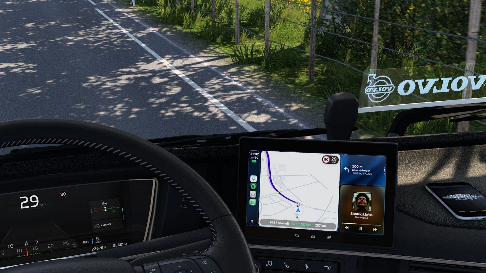<br><sub>In the game: CabPlay on the display of a Volvo FH</sub>

</div>

## What you get

🧭 **Navigation like in a real car** – turn-by-turn directions, the right lane before every junction, signposts like "Exit right · A1 towards Linz", traffic lights with countdown and voice guidance, optionally with a natural-sounding AI voice.

🗺️ **A map built from your game** – made from your own game files with all your DLCs: roads with their lanes, bridges, buildings, water, forests, company yards. In the style of Google Maps or Apple Maps, light and dark.

🎵 **Music** – Spotify with cover art, library and synced lyrics, plus more than 110 radio stations and the stations from your game.

🚚 **Everything for the trip** – your job with deadline and buffer, a dispatcher who texts and calls, vehicle data with warning lights, speed camera and weigh station alerts, fuel & rest stops, weather, a logbook with a map of your routes – and the mirror camera as a blind spot view when you indicate.

⚽ **And more** – live football, NFL and Formula 1, videos from YouTube, Twitch and TikTok (also as picture in picture), a dashboard with widgets the way you like it and an optional voice assistant that runs entirely on your PC.

🖱️ **Control it your way** – with the mouse right on the display in the cab, with steering wheel buttons, the keyboard or your phone.

## Ready in 3 steps

1. **[Download](../../releases/latest)**, install `CabPlay-Setup-….exe` and start CabPlay – it puts its plugin into ETS2 and ATS by itself.
2. **Start the game** and confirm once that it may load SDK plugins.
3. **Get in** – CabPlay appears on the navigation display. Set a destination in the game's navigation or take a job, and off you go.

From then on CabPlay starts with the game and keeps itself up to date. Nothing in the game itself is changed.

## Screenshots

<p align="center">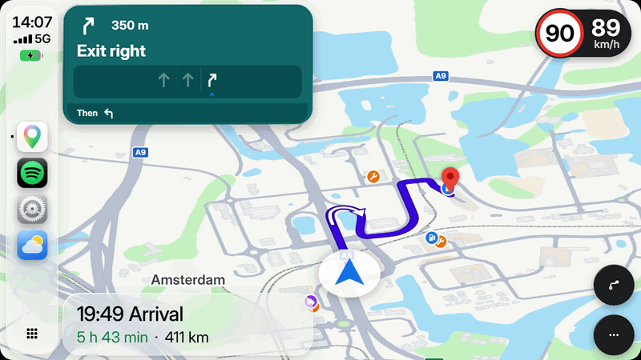<br><sub>Through Amsterdam to the company yard: lane guidance, turn after turn</sub></p>

| | |
|---|---|
| 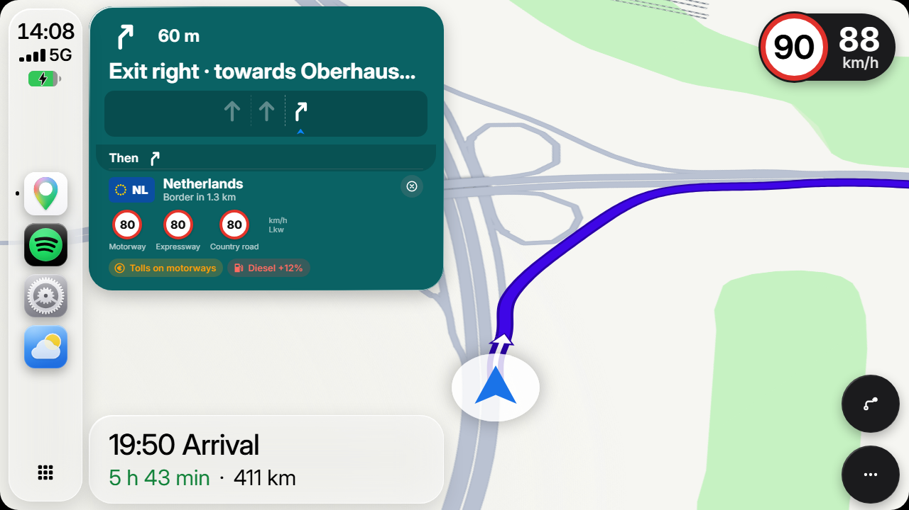 | 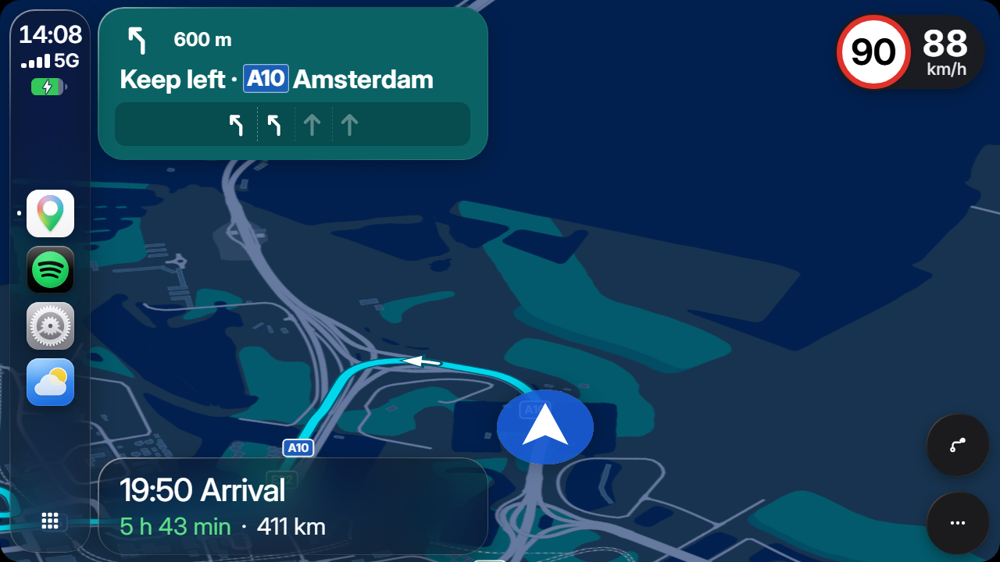 |
| Exit right with lane guidance – and what changes at the border | Almost there: exit right to the company yard |
| 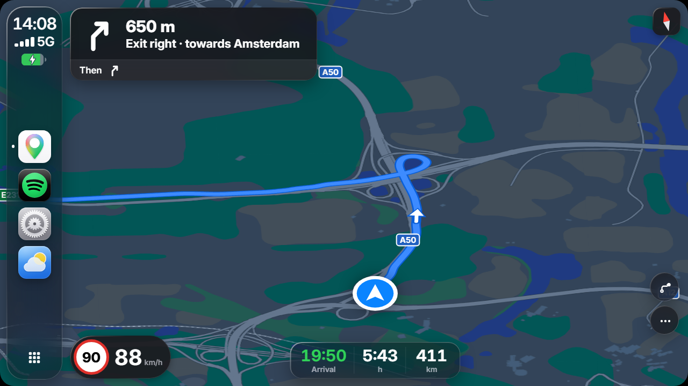 | 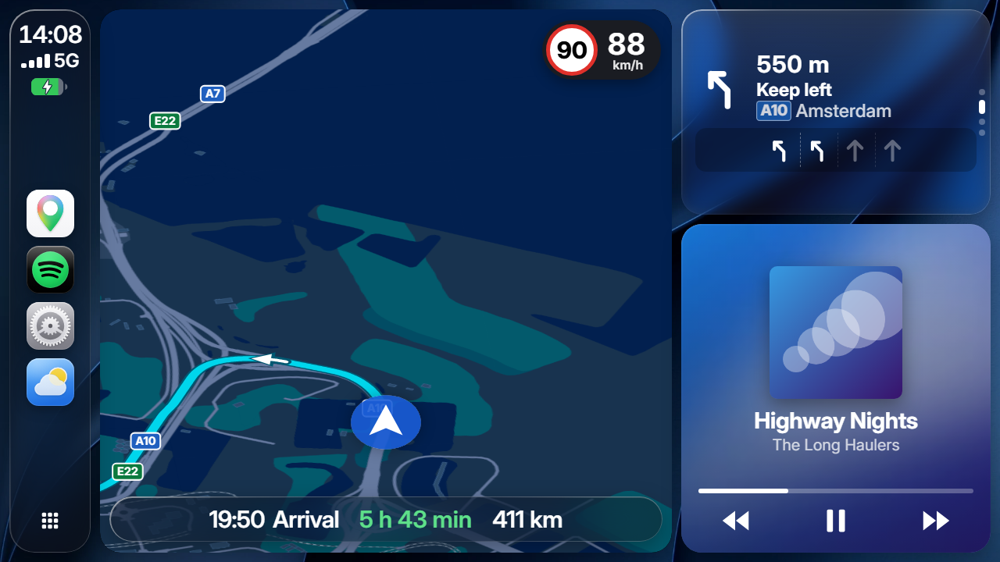 |
| Apple style, with Apple Maps and Music icons | Dashboard at night: navigation and music side by side |
| 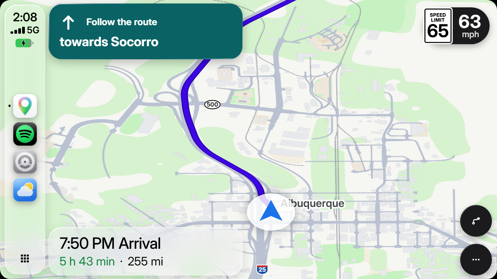 | 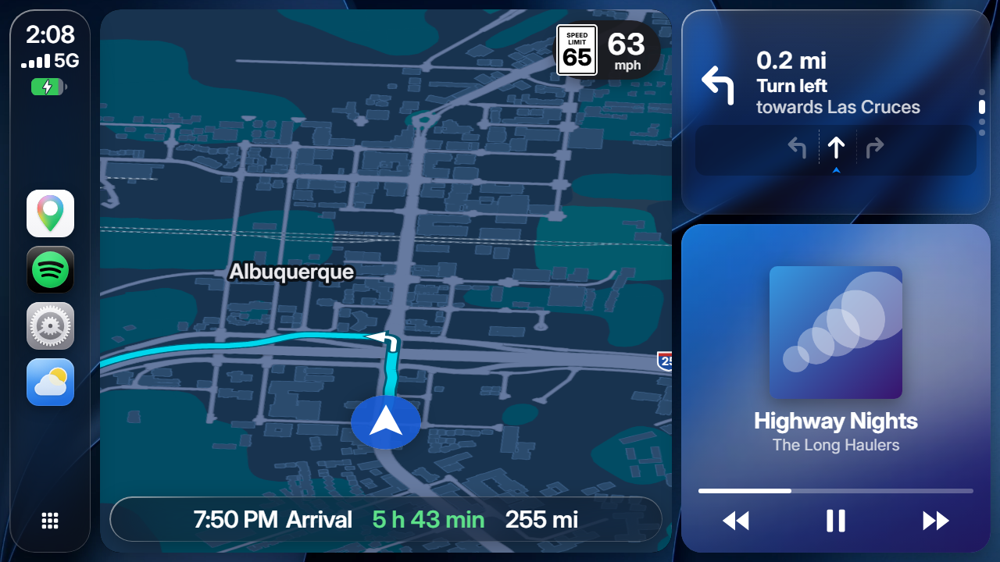 |
| American Truck Simulator: miles, US signs, 12-hour clock | ATS dashboard at night |
| 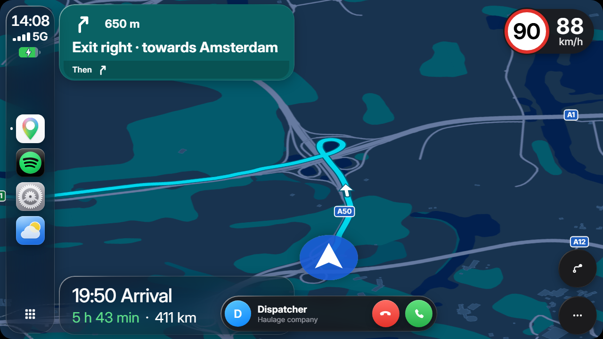 | 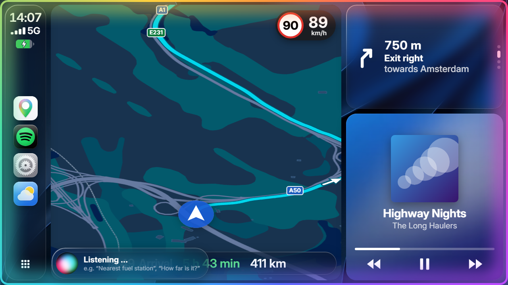 |
| The dispatcher calls | Voice assistant – runs entirely on your PC |
| 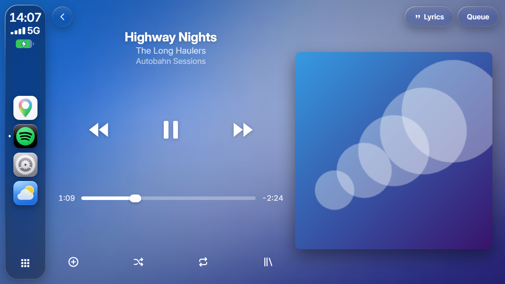 | 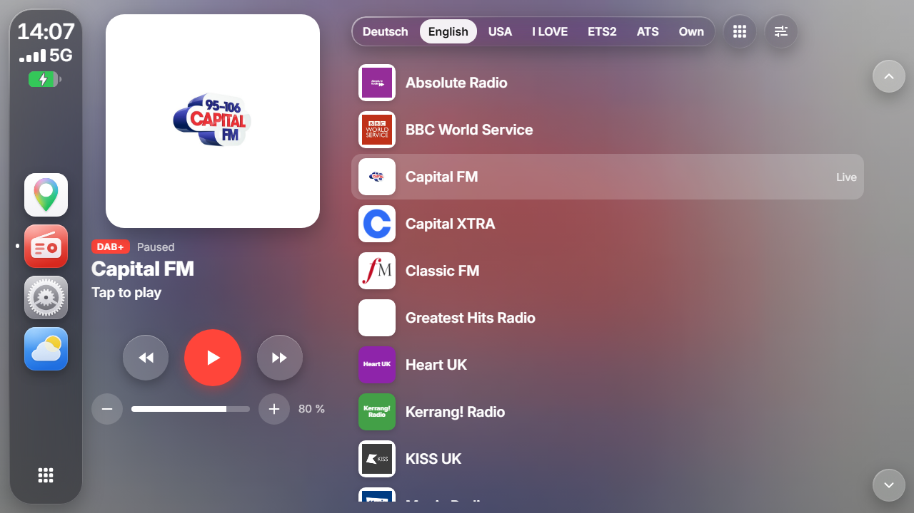 |
| Spotify | More than 110 radio stations |
| 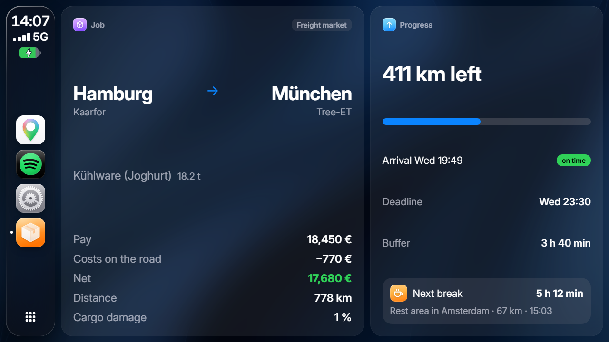 | 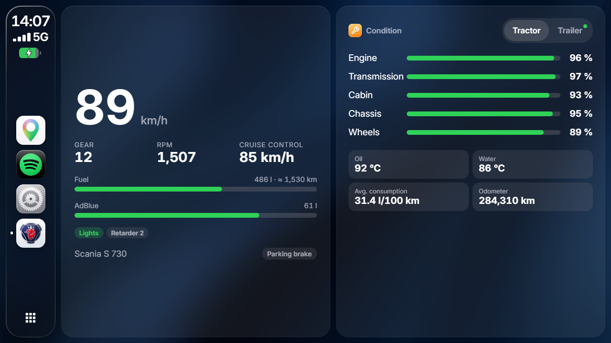 |
| Job with deadline, buffer and next break | Vehicle with condition and warning lights |
| 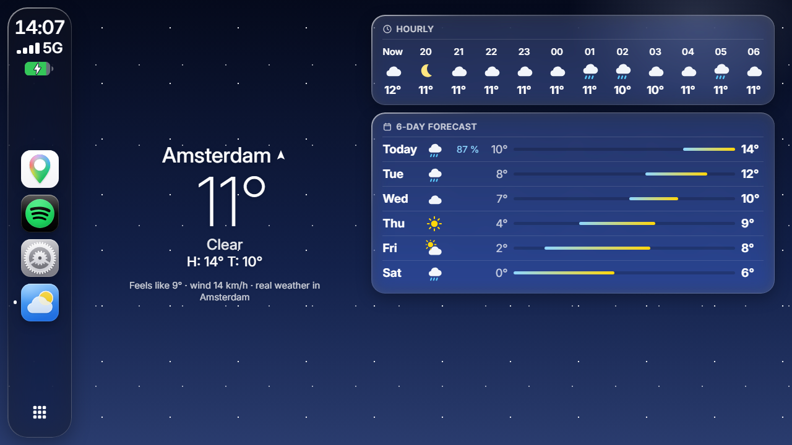 | 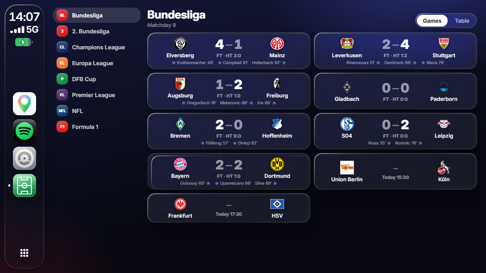 |
| Weather where you are | Live scores |

## Requirements

- Windows 10 or 11 (64-bit)
- Euro Truck Simulator 2 and/or American Truck Simulator, current version on Steam, DirectX 11
- The game's original map with your DLCs – map mods like ProMods or RPM are not supported
- About 350 MB of space (more with the voice assistant)

---

## All the details

<details>
<summary><b>Navigation</b></summary>

- The route comes from the game's navigation. CabPlay detects turns from the game's junction data – the same way the game itself turns
- Lane guidance before every junction and exit, a marker shows which lane you're in
- Ferries with their own "Take the ferry" announcement; direction from signposts only from signs facing your way
- Signposts with road number and destination from the real signs
- Traffic lights with countdown, speed limit, arrival time, rest stops along the route, notices before borders and steep grades
- Voice guidance in German, English, Polish or Turkish, with Windows voices or ten AI voices (about 400 MB, only if you want them). If you're already signaling for the right lane, it won't nag you
- Optional: a warning before tight curves if you're too fast

Distances for turns and lanes are the real distance on the road. The game's navigation counts in compressed game kilometers (about 1:19 in the countryside), so the numbers differ there. Remaining distance, arrival time and distances to fuel stations are converted to match the game.

</details>

<details>
<summary><b>The map</b></summary>

CabPlay reads the map from your game files, with all your DLCs, and rebuilds it by itself after game updates.

- Roads as wide as their lanes, bridges above the roads below, one-way arrows, and up close lane markings and painted turn arrows
- Buildings, water, forests, meadows, fields, rock and sand, company yards with their lots
- Two styles like Google Maps and Apple Maps, light and dark, flat or tilted from behind
- Off by default, switch on any time: 3D buildings, small towns, viewpoints, hidden roads and secret shortcuts

Rivers, lakes, canals and the sea come straight from the game's terrain – from the Rhine to the fjords. Small spots can still be off: if the map is wrong somewhere, choose "Report a map error" in the map menu – feel free to attach it here as an issue.

</details>

<details>
<summary><b>American Truck Simulator</b></summary>

CabPlay detects which game is running by itself – there's nothing to choose.

- Its own map of the USA, built from your game files the first time you play ATS (about five minutes in the background)
- The speed limit as a US "SPEED LIMIT" sign, road numbers as Interstate, US Highway and State Route shields
- States instead of countries: "Welcome to Nevada" with the state's truck speed limits
- Units and clock as set in the game, money in dollars
- Instead of speed cameras (ATS has none), alerts for weigh stations and toll booths
- Radio with its own list of US stations and the ATS online radio
- Road Trip: courier jobs by car, the Bronco and F-150 with their own display shape – when reversing, they show the game's parking camera

Wider displays, e.g. in the Freightliner Cascadia or Western Star 57X, are shown without distortion.

</details>

<details>
<summary><b>Apps</b></summary>

- **Spotify**: without any setup, CabPlay shows and controls what's playing in the Spotify app on your PC. For library, playlists, search and queue, connect your account once (see below). Lyrics scroll along when synced ones exist (LRCLIB)
- **Radio**: more than 110 stations (German, English, USA, I LOVE RADIO) plus your game's online radio and your own stations
- **Sports**: live scores, goal scorers and tables – Bundesliga down to 3. Liga, DFB Cup, Champions League, Premier League, LaLiga, Serie A and more, NFL and Formula 1. Favorite teams get a live ticker as notifications
- **Job**: distance, deadline, buffer, pay, costs on the way, next break
- **Vehicle**: speed, gear, fuel, AdBlue, condition of truck and trailer, warning lights like in the cab
- **Speed cameras**, weigh stations and toll booths with alert sound – cameras that caught you are remembered
- **Weather** for where you are right now (Open-Meteo, no account)
- **Video**: YouTube, Twitch and TikTok, and if you like other websites with a built-in player. Switch apps and the video keeps playing as picture in picture – drag it to any corner, in three sizes. Timeline, seeking, speed up to 2×, resume where you left off, pause during calls and controls in the dashboard's music widget
- **Mirror camera**: in trucks with camera mirrors, the display shows that side's wide-angle mirror when you indicate – like a blind spot camera, optionally in place of a playing video. ETS2: Volvo FH, DAF 2021/XD/XF Electric, Iveco S-Way, Renault T, MAN TGX (untested); ATS: Volvo VNL, Kenworth T680, Freightliner Cascadia
- **Logbook**: if you like, every trip with its route – from, to, cargo, distance, pay, tolls and fines, profit, mini map – plus distance per country and all your driven routes as a layer on the map. Stored only on your PC
- Phone with dispatcher and roadside assistance, messages, calendar, fuel & rest stops
- Ready for the upcoming bus DLC (not released yet): trip instead of cargo, arrival deadline, bus stops on the map

</details>

<details>
<summary><b>Voice assistant (optional)</b></summary>

Hold the Home button (or Ctrl + Alt + V) and just talk, for example "Will I make the delivery?" or "Play something by AC/DC". The language model runs entirely on your PC, costs nothing and needs no account. It's only downloaded if you ask for it in the settings (about 1.5 to 3 GB) and can be removed at any time. Without the download, CabPlay understands fixed commands like "Nearest fuel station" or "How far is it".

</details>

<details>
<summary><b>Controls in the game</b></summary>

| Keys | What happens |
|---|---|
| Ctrl + F8 | CabPlay menu in the game (status, display, touch) |
| Ctrl + Alt + M | Touch mode: use CabPlay with the mouse |
| Ctrl + Alt + E | Editor window on the PC |
| Ctrl + Alt + P | Play or pause music |
| Ctrl + Alt + Page Up / Page Down | Previous or next track |
| Ctrl + Alt + arrow keys, Enter, Backspace | Move through CabPlay, select, back |
| Ctrl + Alt + H | Home screen |
| Ctrl + Alt + V | Voice command |

All shortcuts can be changed, including to steering wheel buttons.

**Touch:** either CabPlay sits as a window over the game, or you calibrate the display in the cab once (click its four corners) and then click right on the screen in the truck – CabPlay compensates for head and cab movement. The calibration is remembered for every truck and car.

**Phone:** switch on phone control in the settings and scan the QR code – phone and PC on the same Wi-Fi.

</details>

<details>
<summary><b>Setting up the Spotify library</b></summary>

1. Sign in at [developer.spotify.com/dashboard](https://developer.spotify.com/dashboard) with your Spotify account and choose "Create app". Any name, tick "Web API".
2. Enter exactly `http://127.0.0.1:8724/callback` as Redirect URI and save.
3. Copy the Client ID.
4. In CabPlay's editor window under Settings › Music › Spotify library, paste the Client ID, click Connect and agree in the browser.

The sign-in stays on your PC (`%APPDATA%\CabPlay`). Playing from the library needs Spotify Premium and an open Spotify app.

</details>

<details>
<summary><b>Updates, mods and backup</b></summary>

- **Updates**: CabPlay checks for a new version at start, downloads it and installs it when you close the app – the plugin too. Every file is checked with SHA-256, your settings stay. Whether there's a desktop shortcut is up to you under Software update
- **Mods**: company and city names from enabled mods also appear on the map. Map mods (ProMods, RPM …) don't work – map and navigation won't match there, everything else works
- **Backup**: Settings › General › "Back up settings …" writes settings, learned speed cameras and videos to a file. Clear the video sites' history and cookies under Settings › Video

</details>

<details>
<summary><b>FAQ</b></summary>

**Windows warns at start ("Windows protected your PC").**
The program isn't digitally signed. Click "More info" and "Run anyway". To be sure, compare the checksum with `SHA256SUMS.txt` in the release:

```powershell
Get-FileHash .\CabPlay-Setup-*.exe -Algorithm SHA256
```

**CabPlay doesn't show up in the game.**
Quit the game completely, start it again and confirm the SDK prompt. In the app, check under Settings › General › Plugin & game that the plugin is installed. Then open the menu in the game with Ctrl + F8 and press Apply.

**The map is empty or outdated.**
Settings › About › Rebuild map. CabPlay does this by itself after game updates.

**Does it cost performance?**
Hardly. CabPlay only redraws what changes and passes the picture to the game via the graphics card.

**I still have "ETS2 CarPlay" (1.12 or older).**
Install `CabPlay-Setup` from the [releases](../../releases/latest) by hand once – settings and data move over, after that CabPlay updates itself again.

</details>

<details>
<summary><b>Uninstalling</b></summary>

Via Windows › Settings › Apps, in CabPlay under Settings › General › Uninstall CabPlay, or with `Deinstallieren.exe` for the ZIP version. This removes the plugin from both games, the placeholders in `Documents\Euro Truck Simulator 2\CabPlay-Display` (or `American Truck Simulator`) and the program folder. Your settings (`%APPDATA%\CabPlay`) only if you want. The game itself stays as it was.

</details>

<details>
<summary><b>Licenses and thanks</b></summary>

- Parts of the game plugin come from the [ETS2LA plugin](https://github.com/ETS2LA/plugin) (MIT).
- The map data is read from the game files by the [TruckSim map parser](https://github.com/truckermudgeon/maps) (GPL-3.0). Its source code is included in every package (`resources/mapdata/parser/QUELLE.txt`).
- Sea areas: [Natural Earth](https://www.naturalearthdata.com/) (public domain). List of villages in the game: krmarci, from the TruckSim map parser.
- Sports: [OpenLigaDB](https://www.openligadb.de/) (German leagues), ESPN (other leagues, NFL), [Jolpica](https://jolpi.ca/) (Formula 1). Truck brand logos: Wikimedia Commons.
- Radio stations: [radio-browser.info](https://www.radio-browser.info/), lyrics: [LRCLIB](https://lrclib.net/), weather: [Open-Meteo](https://open-meteo.com/) and MET Norway.
- Voice assistant: whisper.cpp and llama.cpp (MIT), language model Qwen (Apache 2.0), Supertonic 3 voices by Supertone (OpenRAIL-M) via ONNX Runtime (MIT).
- Font: [Inter](https://github.com/rsms/inter) (SIL Open Font License 1.1). Built with [Electron](https://www.electronjs.org/).

</details>

---

<sub>Fan project, not affiliated with SCS Software, Apple, Google or Spotify. Trademarks belong to their owners. All changes: [CHANGELOG](CHANGELOG.md)</sub>
