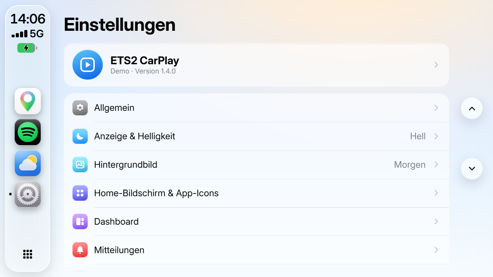

# ETS2 CarPlay

**Deutsch** · [English](README.en.md)

CarPlay-Oberfläche im Stil von iOS 27 für das Navi-Display in **Euro Truck Simulator 2**: Karte mit Abbiegehinweisen, Spotify, Auftrag, Fahrzeug, Blitzer, Telefon und mehr – direkt auf dem Bildschirm im Truck, bedienbar per Maus, Tastatur oder Handy.


> Ein Fan-Projekt. Nicht verbunden mit SCS Software, Apple, Google oder Spotify. Alle Marken gehören ihren Inhabern.

---

## Inhalt

- [Funktionen](#funktionen)
- [Bilder](#bilder)
- [Voraussetzungen](#voraussetzungen)
- [Installieren](#installieren)
- [Erster Start](#erster-start)
- [Bedienung im Spiel](#bedienung-im-spiel)
- [Karte](#karte)
- [Updates](#updates)
- [Häufige Fragen](#häufige-fragen)
- [Deinstallieren](#deinstallieren)
- [Lizenzen und Danksagungen](#lizenzen-und-danksagungen)

---

## Funktionen

**Karte und Navigation**
- Eigene Karte aus den Spieldateien: Straßen, Kreuzungen, Kreisverkehre, Gebäude, Meer, Flüsse und Seen, Wälder, Wiesen, Firmen-, Werkstatt- und Händlergelände, Steinbrüche
- Kartenstile wie **Google Maps** oder **Apple Karten**, jeweils hell und dunkel; 2D oder geneigte 3D-Ansicht; Auto-Zoom nach Tempo
- Die Navi-Route kommt direkt aus dem Spiel (Ziel im Spiel-Navi setzen)
- Abbiegehinweise mit Entfernung, Richtung, **Spurempfehlung** und „Dann …“-Hinweis; Ansagen auf Deutsch oder Englisch
- **Ampeln** an der Strecke, mit Phase und Restzeit
- Tempolimit und eigene Geschwindigkeit, Ankunftszeit, Restzeit und Entfernung
- Tankstellen, Rastplätze, Werkstätten, Händler, Waagen, Fähren und Züge als Kartensymbole

**Blitzer und Warnungen**
- Blitzer, Waagen und Mautstellen voraus, mit Warnton und Warnkarte
- Lernt jeden Blitzer, der dich erwischt, dazu eigene Meldungen
- Warnung bei zu hohem Tempo (Toleranz einstellbar)

**Apps**
- **Spotify**: Titel, Cover und Steuerung
- **Auftrag**: Strecke, Lieferfrist, Puffer, Lohn, nächste Pause
- **Fahrzeug**: Tempo, Gang, Drehzahl, Tank, AdBlue, Zustand von Zugmaschine und Anhänger
- **Tanken & Rasten**, **Fahrtenbuch**, **Kalender**, **Wetter**, **Telefon**, **Nachrichten** vom Disponenten, **Mitteilungen**
- Frei anpassbares **Dashboard** mit Widgets, eigene Hintergründe und App-Symbole

**Bedienung**
- **Touch-Modus** im Spiel: CarPlay als verschiebbares Fenster oder **direkt auf dem Display im Cockpit**, mit Ausgleich der Kopf- und Kabinenbewegung
- Tastenkürzel für alle wichtigen Funktionen
- **Handy-Steuerung** im WLAN, per QR-Code verbunden
- Editor-Fenster am PC zum Einrichten

**Allgemein**
- Deutsch und Englisch, metrische, US- und UK-Einheiten, 12-/24-Stunden-Uhr
- Automatische Updates; die Kartendaten erzeugt die App nach Spiel-Updates selbst neu
- Das Spiel bleibt unverändert: keine Mods in den Spieldateien, keine Änderung an der `config.cfg`

---

## Bilder

| | |
|---|---|
|  |  |
| Navigation im Google-Stil, hell | Navigation im Google-Stil, dunkel |
|  |  |
| Dashboard mit Navi- und Musik-Widget | Home-Bildschirm |
|  |  |
| Auftrag | Fahrzeug |
|  |  |
| Blitzer | Einstellungen |

---

## Voraussetzungen

- Windows 10 oder 11 (64 Bit)
- Euro Truck Simulator 2 (aktuelle Version, Steam), DirectX 11
- Rund 350 MB Speicherplatz

---

## Installieren

1. Euro Truck Simulator 2 **beenden**.
2. Unter [Releases](../../releases) die neueste Version laden:
   - **`ETS2-CarPlay-Setup-<Version>.exe`** – Installer, Programmordner frei wählbar, erscheint unter Windows „Apps“, oder
   - **`ETS2-CarPlay-<Version>.zip`** – ohne Installation: entpacken und `ETS2 CarPlay.exe` starten.
3. Die App findet ETS2 über Steam und kopiert das Plugin selbst ins Spiel (`bin\win_x64\plugins`).
   Den Stand siehst du in der App unter **Einstellungen › Allgemein › Plugin & Spiel**.

---

## Erster Start

1. ETS2 starten. Beim ersten Start fragt das Spiel nach den **SDK-Plugins** – mit **OK** bestätigen.
   Ab jetzt startet das Spiel die CarPlay-App automatisch mit.
2. In einen Truck mit Navi-Bildschirm steigen – CarPlay erscheint auf dem Display.
3. Mit **Strg + F8** das CarPlay-Menü im Spiel öffnen: Bildschirme wählen (GPS, Dashboard, eigene) und **Anwenden** drücken.
4. Fürs Navi ein Ziel im Spiel-Navi setzen oder einen Auftrag annehmen.

Die Karte erzeugt die App beim ersten Start aus deinen Spieldateien (ein bis zwei Minuten, im Hintergrund).

---

## Bedienung im Spiel

| Taste | Funktion |
|---|---|
| **Strg + F8** | CarPlay-Menü im Spiel (Bildschirme, Touch, Status) |
| **Strg + Alt + M** | Touch-Modus an/aus – CarPlay mit der Maus bedienen |
| **Strg + Alt + E** | Editor-Fenster am PC (Dashboard, Widgets, Einstellungen) |
| **Strg + Alt + P** | Musik: Wiedergabe/Pause |
| **Strg + Alt + Bild↑ / Bild↓** | Musik: vorheriger/nächster Titel |
| **Strg + Alt + Pfeiltasten, Enter, Rücktaste** | Durch CarPlay navigieren, auswählen, zurück |
| **Strg + Alt + H** | Home-Bildschirm |

Alle Kürzel lassen sich in der App bzw. im Menü ändern.

**Touch-Modus**
- **Fenster**: CarPlay als Fenster im Spiel, frei verschieb- und skalierbar.
- **Direkt am Display**: einmal kalibrieren (die vier Ecken des Displays im Cockpit anklicken), danach klickst du direkt auf den Bildschirm im Truck. Kopf- und Kabinenbewegungen werden ausgeglichen.
- Die Leiste oben lässt sich auf **immer**, **klein** (nur ein Punkt, klappt beim Drüberfahren auf) oder **unsichtbar** stellen.

**Handy-Steuerung**: In den Einstellungen einschalten und den QR-Code mit dem Handy scannen (gleiches WLAN).

---

## Karte

Die Karte wird aus den Dateien deines Spiels erzeugt – mit allen DLCs, die du besitzt – und nach Spiel-Updates automatisch neu gebaut.

- **Ebenen** (einzeln abschaltbar): Gebäude, Wasser, Wälder, Wiesen & Büsche, Firmengelände & Steinbrüche, Firmennamen, Ampeln, Straßennummern, Kulissenstraßen
- **Gewässer** kommen aus dem Spiel selbst (Flüsse, Seen, Häfen, Meeresflächen); das offene Meer aus Natural Earth, an die Küsten des Spiels angepasst.
- **Kulissenstraßen**: Straßen, die das Spiel nicht auf seiner Karte zeigt und die nicht ans Straßennetz angeschlossen sind – gestrichelt einblendbar.

Hinweis: ETS2 staucht Europa stark (z. B. liegen Dover und Calais nur wenige Kilometer auseinander). Die Karte zeigt die Welt **so, wie sie im Spiel ist**.

---

## Updates

Die App sucht einmal am Tag nach einer neuen Version (**Einstellungen › Allgemein › Softwareupdate**), lädt sie und installiert sie beim Beenden – das Plugin gleich mit. Einstellungen bleiben erhalten. Jede Datei wird vor der Installation per SHA-256 geprüft.

---

## Häufige Fragen

**Windows warnt beim Start („Der Computer wurde durch Windows geschützt“).**
Die Programmdatei ist (noch) nicht digital signiert, deshalb kennt Windows SmartScreen den Herausgeber nicht. Klicke auf **Weitere Informationen › Trotzdem ausführen**.
Prüfen, dass die Datei unverändert ist: Die Prüfsummen stehen im jeweiligen Release in `SHA256SUMS.txt`. In PowerShell:

```powershell
Get-FileHash .\ETS2-CarPlay-Setup-1.4.0.exe -Algorithm SHA256
```

**CarPlay erscheint nicht im Spiel.**
ETS2 einmal komplett beenden und neu starten, die SDK-Abfrage bestätigen. In der App unter **Einstellungen › Allgemein › Plugin & Spiel** prüfen, ob das Plugin installiert ist. Im Spiel mit **Strg + F8** den gewünschten Bildschirm wählen und **Anwenden**.

**Die Karte ist leer oder veraltet.**
**Einstellungen › Info › Karte neu erzeugen**. Nach Spiel-Updates passiert das automatisch.

**Kostet es Leistung?**
Die App zeichnet nur neu, wenn sich etwas ändert, und überträgt das Bild per GPU. Auf üblichen Spiele-PCs ist kein Unterschied spürbar.

**Funktioniert es mit American Truck Simulator?**
Nein, nur mit Euro Truck Simulator 2.

---

## Deinstallieren

- Über Windows **Einstellungen › Apps** (Installer-Version), oder
- in der App: **Einstellungen › Allgemein › ETS2 CarPlay deinstallieren**, oder
- `Deinstallieren.cmd` im Programmordner (ZIP-Version).

Entfernt werden das Plugin im Spiel, die Platzhalter in `Dokumente\Euro Truck Simulator 2\ETS2CarPlay` und der Programmordner – auf Wunsch auch die Einstellungen (`%APPDATA%\ETS2 CarPlay`). Das Spiel selbst bleibt unverändert.

---

## Lizenzen und Danksagungen

- Teile des Spielplugins stammen aus dem [ETS2LA-Plugin](https://github.com/ETS2LA/plugin) (MIT).
- Kartendaten werden mit dem [TruckSim-Kartenparser](https://github.com/truckermudgeon/maps) (GPL-3.0) aus den Spieldateien gelesen; Quelle liegt jedem Paket bei (`resources/mapdata/parser/QUELLE.txt`).
- Meeresflächen: [Natural Earth](https://www.naturalearthdata.com/) (gemeinfrei).
- Schrift: [Inter](https://github.com/rsms/inter) (SIL Open Font License 1.1).
- Oberfläche gebaut mit [Electron](https://www.electronjs.org/).
